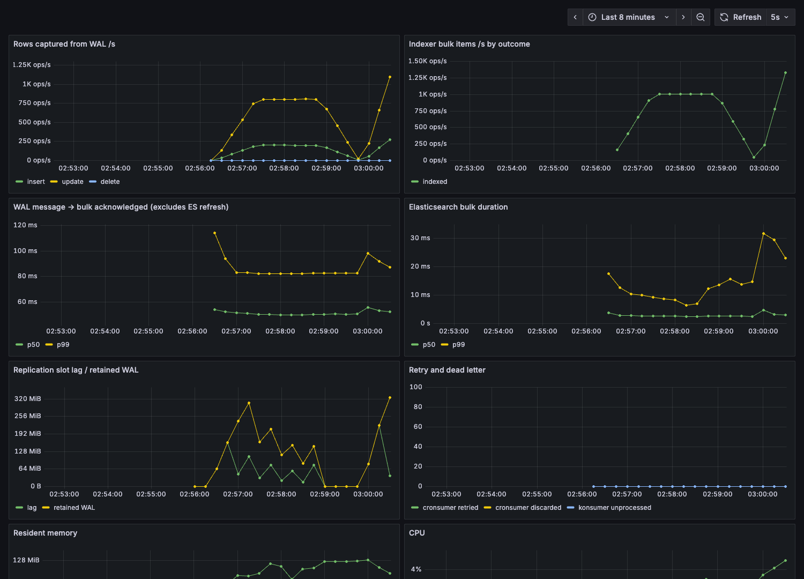

# pg-search-sync

[](https://github.com/chipontix/pg-search-sync/actions/workflows/ci.yml)

Product catalog sync **PostgreSQL → Kafka → Elasticsearch** built on Trendyol's
open-source Go libraries, with measured write→searchable latency, a 10M-row
catch-up benchmark against Debezium under equal resource limits, and a failure
matrix in which an independent reconciliation tool has to find zero lost
documents.

Personal project. It is not Trendyol code and not affiliated with Trendyol; it
uses their public libraries for the read-model pattern their engineering blog
([medium.com/trendyol-tech](https://medium.com/trendyol-tech)) describes:
writes go to PostgreSQL, reads are served from a search store.

```bash
make demo        # stack up, 10k products seeded, reconciled, one search
make reproduce   # every number below (about 2 hours, Docker only + Go + JDK 21 for the Stove tests)
```

## Architecture

```
            writes                                     reads
 client ──────────► PostgreSQL 17                 Elasticsearch 8.19 ◄────── GET /search (api)
                    products (+ version trigger)         ▲
                         │ logical replication           │ _bulk, version_type=external
                         │ (pgoutput, slot)              │
                         ▼                               │
                  cdc (go-pq-cdc-kafka)            indexer (kafka-konsumer)
                         │ key = product id              ▲   │ still failing     │ 4xx / poison
                         │ acks=all, then WAL ack        │   ▼                   ▼
                         └────► products.cdc ────────────┘ products.retry      products.dlq
                                (Redpanda, 6 partitions)   (kafka-cronsumer: every 15 s, 20 tries)
```

| Piece | Library | Role |
|---|---|---|
| `cmd/cdc` | [go-pq-cdc-kafka](https://github.com/Trendyol/go-pq-cdc-kafka) v1.4.5 | Reads `public.products` from a replication slot; one Kafka message per row change; acknowledges the WAL position only after Kafka accepted the batch. |
| `cmd/indexer` | [kafka-konsumer](https://github.com/Trendyol/kafka-konsumer) v2.6.19, [kafka-cronsumer](https://github.com/Trendyol/kafka-cronsumer) v1.8.11 | Batch consumer, one `_bulk` per batch; in-process retries, then the retry topic, then the DLQ. |
| `cmd/api` | stdlib | `GET /search?q=&brand=&category=&min_price=&max_price=&limit=` |
| `cmd/reconcile` | pgx | Merge-joins the source and the index by id, exits 1 on any missing, stale or extra document; `-repair` re-emits them. |
| `cmd/loadgen` | pgx | Fixed-rate writer plus the write→searchable probe; `-seed N` bulk loads. |
| `cmd/all` | | cdc + indexer + api in one process (Stove, local runs). |
| `cmd/dcp-indexer` | [go-dcp-elasticsearch](https://github.com/Trendyol/go-dcp-elasticsearch) v1.3.8 | Optional second path from Couchbase. |
| chaos proxy | [gaos](https://github.com/Trendyol/gaos) | Between the indexer and Elasticsearch; answers `_bulk` with 429. |
| e2e | [Stove](https://github.com/Trendyol/stove) 0.27.5 | Black-box tests of the `cmd/all` binary. |

## Delivery guarantees

At-least-once end to end, made idempotent at the sink.

1. **Source version.** A `BEFORE INSERT OR UPDATE` trigger stamps every row
   with `nextval()` of one sequence (step 2, always even). BEFORE-row triggers
   run after the row lock is taken, so per row the version order is the commit
   order. ([`init.sql`](deploy/postgres/init.sql))
2. **CDC.** go-pq-cdc-kafka acknowledges a WAL position only after the batch
   holding it is written with `acks=all`; a crash replays from the slot.
3. **Indexer.** Offsets are committed after the batch is processed. Every
   document goes to Elasticsearch with `version_type=external`, so a replay
   or a late retry of an older version gets `409` and counts as done, and the
   newer version wins whatever the arrival order. This is what makes
   kafka-cronsumer safe to use here: it does not preserve order.
4. **Deletes are tombstones** at `version+1` (odd): newer than the deleted
   row, older than any re-insert of the same id. A real delete would forget
   its version after `index.gc_deletes` (60 s) and a late retry could bring
   the product back. Search filters `deleted=false`.
5. **Failure routing per bulk item.** 2xx/409 done. 429, 5xx and network
   errors: retried in process with exponential backoff for `BULK_RETRY_FOR`
   (30 s) while offsets stay uncommitted, i.e. backpressure. Still failing:
   retry topic, then DLQ after 20 attempts. Other 4xx and undecodable
   messages go straight to the DLQ.
6. **Backstop.** `reconcile -repair` touches rows that are missing or stale
   in the index (the trigger bumps the version, CDC re-emits them) and writes
   tombstones for documents whose row is gone. See
   [the cronsumer finding](docs/upstream.md) for why it exists.
7. **Initial snapshot, opt-in.** By default rows written before the slot
   exists are not indexed. `SNAPSHOT=initial` on `cdc` copies the table once
   through go-pq-cdc's snapshotter: it creates the slot, records the current
   LSN, exports a snapshot and copies the rows in chunks, then streams the WAL
   from that LSN. A row changed while the copy runs comes twice, old copy then
   new WAL event; one changed between the LSN and the export comes new copy
   then old WAL event, which the external version rejects. The integration
   test seeds 50,000 rows and runs updates during the copy: 1,060 of 2,237
   updates landed while the snapshot job was open, and the index matched the
   table in count and sum of versions
   ([log](bench/results/snapshot/it.log), `make it`).

## Results

Hardware: MacBook Pro, Apple M4 Max, 48 GB; everything in one colima VM with
10 vCPU / 20 GB, shared with unrelated workloads on the host (each result line
records the host load average). Raw results: [`bench/results`](bench/results).

The tables and the line under each are generated from `bench/results/*.jsonl`
by `make tables` ([`bench/tables.py`](bench/tables.py)); CI fails if they are
out of date. Numbers marked *(observed)* were read off a console or the
dashboard during the runs and are not in `bench/results`.

### Write → searchable latency

[`bench/latency.sh`](bench/latency.sh): 1M-row table, 256 connections, 80%
`UPDATE` of a random row / 20% `INSERT`, autocommit with
`synchronous_commit=on`, 3 runs × 60 s per rate after a 10 s warm-up. One write
in ten is probed: the clock starts when `COMMIT` returns and stops when a
`_search` (polled every 20 ms with all pending ids) first returns that id at
that version or newer. `_search` only sees refreshed segments, so this is "a
user can find it", not a real-time `GET`.

<!-- generated:latency -->
| target writes/s | achieved | p50 | p90 | p99 (3 runs) | max | probes, not found |
|---|---|---|---|---|---|---|
| 1,000 | 968–1,000 | 603 ms | 1,000 ms | 1,092–1,112 ms | 3.2 s | 17,772, 0 |
| 5,000 | 4,467–4,810 | 649 ms | 1,053 ms | 1,158–1,182 ms | 4.5 s | 84,224, 0 |
| 10,000 | 8,366–8,973 | 736 ms | 1,170 ms | 1,289–1,395 ms | 4.8 s | 158,091, 0 |

p50/p90 are medians of the runs. Pipeline part (WAL message → bulk acknowledged, indexer histogram): p50 54–79 ms (median per rate), p99 0.1–2.2 s across runs.
<!-- /generated -->

After the series reconcile reported 0 mismatches on 2,308,150 rows
*(observed; `latency.sh` now appends that reconcile line to
`latency.jsonl`)*.

- **The floor is `refresh_interval: 1s`.** The pipeline part (line under the
  table) is tens of milliseconds; the rest is waiting for the next refresh,
  uniformly 0–1 s.
- **The targets above 1,000/s are not reached** because commits stall on the
  VM's virtual disk: `/proc/pressure/io` showed `full avg10 ≈ 7–8 %` *(observed)*,
  i.e. every task blocked on IO 7–8 % of the time. The same stalls produce the
  3–5 s maxima. A first series with 64 connections reached even less and is
  kept as recorded (`latency-64-workers.jsonl`).
- The pipeline-only p99 from the histogram varies widely across runs and is
  sometimes above the end-to-end p99. The two do not count
  the same population (every change vs a 1-in-10 sample, clocks starting at
  WAL send vs COMMIT return) and I have not reconciled them, so it is not a
  headline number.

### Catch-up: 10M rows, go-pq-cdc-kafka vs Debezium

[`bench/catchup.sh`](bench/catchup.sh): the connector is stopped, 10M rows are
inserted (100 transactions of 100k rows, ~3 GB of WAL behind the slot), the
connector is started and timed until all 10M change events are in Kafka. CPU
and memory come from the container's cgroup (`cpu.stat`, `memory.stat`
anon ≈ RSS, `memory.peak`). **Both connectors get the same limits.**

<!-- generated:catchup -->
| limits | connector | time | rows/s (median) | CPU-seconds | peak anon memory |
|---|---|---|---|---|---|
| 1 CPU, 1 GB | go-pq-cdc-kafka v1.4.5 | 52.4 / 56.1 / 57.8 s (3 runs) | 178k | 51–56 | 68–75 MB |
| 1 CPU, 1 GB | Debezium 3.2 (Kafka Connect) | 178.1 / 199.9 / 204.0 s (3 runs) | 50k | 178–204 | 825–832 MB |
| 2 CPU, 1 GB | go-pq-cdc-kafka v1.4.5 | 36.2 s (1 run) | 276k | 61 | 65 MB |
| 2 CPU, 1 GB | Debezium 3.2 (Kafka Connect) | 87.4 s (1 run) | 114k | 163 | 848 MB |

At 1 CPU go-pq-cdc-kafka is 3.6× faster with 3.7× less CPU and 11.2× less memory; at 2 CPUs 2.4× faster (ratios of medians).
<!-- /generated -->

Both are tuned for throughput (go-pq-cdc-kafka batch
10,000 / 100 ms; Debezium `max.batch.size` 10,000, `max.queue.size` 40,000,
producer `linger.ms` 100, 1 MB batches, lz4, heap 640 MB). Debezium writes
its full JSON envelope (before/after/source), go-pq-cdc-kafka this project's
compact event, so the bytes on the wire differ.

**Trendyol's own numbers**, from the
[go-pq-cdc-kafka README](https://github.com/Trendyol/go-pq-cdc-kafka#benchmark-results)
(their measurement, not reproduced here): 10M rows in 2.5 min vs 21 min, max
CPU 44 % vs 181 %, max memory 130 MB vs 1.07 GB, on an M1 Pro with go-pq-cdc
limited to 1 CPU and Debezium to 2 CPUs.

### Failure matrix

[`bench/chaos.sh`](bench/chaos.sh): 2,000 writes/s for 120 s per scenario, one
fault injected 20 s in, then `reconcile` must report **zero missing, stale or
extra documents** against PostgreSQL.

<!-- generated:chaos -->
| scenario | through retry topic | DLQ | missing / stale / extra | converged in |
|---|---|---|---|---|
| kill -9 indexer, back after 10 s | 0 | 0 | 0 / 0 / 0 | 21 s |
| kill -9 indexer three times | 0 | 0 | 0 / 0 / 0 | 45 s |
| kill -9 cdc connector, 10 s | 0 | 0 | 0 / 0 / 0 | 48 s |
| kill -9 Redpanda (the broker), 20 s | 0 | 0 | 0 / 0 / 0 | 26 s |
| restart PostgreSQL | 0 | 0 | 0 / 0 / 0 | 25 s |
| gaos: 429 on every 2nd `_bulk` | 0 | 0 | 0 / 0 / 0 | 24 s |
| gaos: 429 on every `_bulk` for 60 s | 4,196 | 0 | 0 / 0 / 0 | 54 s |
| … plus kill -9 indexer inside the window | 4,136 | 0 | 0 / 0 / 0 | 57 s |
| … plus kill -9 while cronsumer drains (3 runs) | 4,020–4,143 | 0 | 0 / 0 / 0 | 59–62 s |

2.38–2.95M rows at the time of the checks; one full reconcile pass took 21–29 s.
<!-- /generated -->

"Converged in" is measured after the load stops and includes one full
reconcile pass (time above). `-repair` was never needed in these runs.

This table is from October, with `chaos.sh` as it was then. The drain row used a
fixed delay before the kill and recorded no consumer group state, so it does not
show whether the retry topic still had records at that moment. In a later run
that delay landed at lag 0, and `chaos.sh` now polls the group and kills while
the committed offset is moving. Run the same way today, the 429 window also opens
later relative to the load.

### Optional second path: Couchbase → go-dcp-elasticsearch

[`bench/couchbase.sh`](bench/couchbase.sh): Couchbase Server 7.6.2 Community,
100k seeded documents, writes through N1QL, 3 × 60 s, DCP lag from go-dcp's
`cbgo_total_lag_current` sampled every second.

<!-- generated:couchbase -->
| target | achieved | p50 | p99 | DCP lag mean / max (mutations) |
|---|---|---|---|---|
| 1,000 | 1,000 | 4.3–4.8 s | 9.7–10.9 s | 4.4k–5.0k / 9.7k–10.4k |
| 5,000 | 817–1,550 | 3.5–6.7 s | 9.4–13.0 s | 2.4k–7.5k / 17.5k–25.1k |

Reconcile afterwards: 224,522 documents, 0 mismatches. Highest achieved N1QL write rate: 1,550/s.
<!-- /generated -->

N1QL writes top out at
the highest achieved rate above on this VM, so the second row is not a
5,000/s test. Idle, a single write reaches a real-time `GET` in ~490 ms every
time *(observed)*. Under load the bulk requests take ~17 ms *(observed)* while `cbgo_dcp_latency_ms` is in seconds, so the delay
is before the connector's listener; I have not isolated where.

## Observability

Prometheus scrapes the CDC connector (go-pq-cdc metrics: capture rates, slot
lag, retained WAL) and the indexer (bulk outcomes, bulk duration, WAL→ack
lag, konsumer/cronsumer counters). Grafana at <http://localhost:3000> is
provisioned with one dashboard:



## Tests

| what | how | |
|---|---|---|
| unit | `make test` (`go test -race ./...`) | bulk outcome routing against a fake ES, tombstone versions, histogram quantiles |
| integration | `make it` | testcontainers-go: PostgreSQL, Redpanda, Elasticsearch; cdc + indexer in process under `-race`; insert/update/delete/re-insert and a replayed old event; `SNAPSHOT=initial` with updates running while the snapshot is read |
| e2e | `make e2e` | Stove runs the `cmd/all` binary (built with `-race`) against PostgreSQL, Kafka, Elasticsearch; includes pausing Elasticsearch |

All three run in [CI](.github/workflows/ci.yml).

## Limitations

- One node of everything, one laptop VM, shared host; absolute numbers are
  for comparison within this setup, not capacity planning.
- The initial snapshot (`SNAPSHOT=initial`) is off by default and covered by
  one integration test on a 50k-row table, not benchmarked: its speed on
  millions of rows and a crash in the middle of it (the library restarts the
  copy from scratch) are not measured.
- Tombstones are never purged. A purge older than the longest possible retry
  (20 × 15 s) would be safe; not implemented.
- The schema is fixed: `dynamic: strict` mapping and a hand-written event.
  A column change needs a code change and a reindex.
- `reconcile` holds the whole source scan in one transaction and reads the
  index with `search_after`; fine for a few million rows, slow beyond.
- Couchbase writes use N1QL without a durability level (memory ack on the
  active node), and that path has no tombstones: DCP ordering makes them
  unnecessary for replays, but a DLQ there would need them.

## Upstream

[docs/upstream.md](docs/upstream.md): a kafka-cronsumer crash window that
loses retry records when a handler is slower than the commit interval
(standalone reproduction), and three gaos bugs (data races, query string
dropped by `redirect`, `span` ignoring `end`), each with a script.

For the cronsumer one there is a fix with a regression test on
[`chipontix/kafka-cronsumer` `fix/commit-after-handled`](https://github.com/chipontix/kafka-cronsumer/tree/fix/commit-after-handled);
the issue and PR text, the library's contribution rules and how to check it
are in [UPSTREAM-PR.md](UPSTREAM-PR.md). Not filed upstream yet. Against a real broker
(Kafka 3.9.1, 1500 ms handler, five SIGKILLs) v1.8.11 lost 10 of 20 records
and the fork lost 0 of 20, with 4 duplicates (24 handler calls for 20
records): the fix makes the retry path at-least-once, not exactly-once, so the
handler still has to be idempotent (here, `version_type=external` makes it so).
Raw output: [`bench/results/cronsumer-crash/`](bench/results/cronsumer-crash/).
The full failure matrix then ran on the `cronsumer-commit-after-handled` branch,
with the indexer binary built from the fork:

<!-- generated:chaos_fix -->
| scenario | through retry topic | DLQ | missing / stale / extra | converged in |
|---|---|---|---|---|
| … plus kill -9 while cronsumer drains (3 runs) | 145–156 | 0 | 0 / 0 / 0 | 5–28 s |
| gaos: 429 on every `_bulk` for 60 s | 4,096 | 0 | 0 / 0 / 0 | 5 s |
| … plus kill -9 indexer inside the window | 159 | 0 | 0 / 0 / 0 | 10 s |
| kill -9 indexer, back after 10 s | 0 | 0 | 0 / 0 / 0 | 9 s |
| kill -9 indexer three times | 0 | 0 | 0 / 0 / 0 | 10 s |
| kill -9 cdc connector, 10 s | 0 | 0 | 0 / 0 / 0 | 12 s |
| kill -9 Redpanda (the broker), 20 s | 0 | 0 | 0 / 0 / 0 | 7 s |
| restart PostgreSQL | 0 | 0 | 0 / 0 / 0 | 7 s |
| gaos: 429 on every 2nd `_bulk` | 0 | 0 | 0 / 0 / 0 | 15 s |

11 runs, 2,615,744 writes, 0 documents missing, stale or extra. 0.24–0.71M rows at the checks. At the 3 drain kills the retry topic had 86–101 records behind a committed offset that was moving. Host load average at the start of each run: 11–34.
<!-- /generated -->

What this does and does not show. It shows no regression: nothing was lost
without `-repair`. It does not show that the fix is needed, because the matrix on
v1.8.11 above also lost nothing; only the SIGKILL reproduction separates the two.
The two tables are not comparable on time: this run used a 4 CPU / 6 GB VM
([smaller heaps, other host ports, `postgres:17-alpine`, binaries built on the
host](deploy/docker-compose.small-vm.yml)), a table that started empty and a
busy host. In the drain and kill-indexer runs the indexer was still handing
records to the retry topic when it was killed and the logs show no hand-off after
that, so they carry far fewer retry-topic records than the plain 429 run. Each
run kills at one moment; this is not a search of all crash points.

```bash
git checkout cronsumer-commit-after-handled && make bin-linux
export COMPOSE_EXTRA=deploy/docker-compose.small-vm.yml CHAOS_RESULTS=bench/results/chaos-cronsumer-fix
make chaos
make chaos SCENARIOS="es-429-60s-kill-in-drain es-429-60s-kill-in-drain"
```

Raw output: [`bench/results/chaos-cronsumer-fix/`](bench/results/chaos-cronsumer-fix/),
including a [first attempt](bench/results/chaos-cronsumer-fix/first-attempt/ABOUT.md)
that found the problems fixed before this pass.

## How it was built

The code, tests, benchmarks and documentation in this repository were written
by an AI coding agent, Claude Code (Anthropic), to Rabiya's specification and
under her direction. She set the goals, the constraints and what had to be
measured, and she decides what is accepted and published. The upstream
kafka-cronsumer fix and its tests were made the same way, and the issue and PR
texts in [UPSTREAM-PR.md](UPSTREAM-PR.md) say so. The commits are under her
GitHub account.

How the claims are kept checkable rather than taken on trust:

- every benchmark script appends its raw result to `bench/results/`, and the
  README tables are generated from those files (`make tables`, checked in CI);
- the few numbers that were only observed are marked *(observed)*;
- "no lost documents" is decided by `reconcile`, an independent comparison of
  PostgreSQL with the index, not by the pipeline's own logs;
- the upstream bug has a regression test that fails on the library's `main`
  and a SIGKILL reproduction against a real broker, both runnable from this
  repository.
